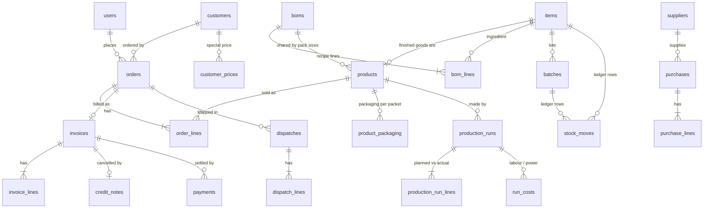

# Design note

## 1. Data model (ER)

`stock_moves` is the single source of truth for stock. Its `source_type/source_id/source_ref` columns point at the purchase, production run, dispatch, credit note or adjustment that caused each row. `audit_log` records who changed what, when, with before/after JSON and a reason.

## 2. How stock is computed
* **Balance = `SUM(stock_moves.qty)`**: nothing stores a balance that someone could overwrite. `opening + receipts − issues ± adjustments = closing` is exactly what the *Stock summary* report prints per period, and `/api/stock/reconcile` re-derives item totals from batch totals and fails on any negative batch.
* Rows are **append-only** (database triggers reject UPDATE/DELETE on `stock_moves`, `audit_log`, `invoice_lines`, `credit_notes`, and DELETE on `invoices`). Mistakes are fixed by a reversing row: a *void run* posts opposite movements, a *credit note with return* posts `SALES_RETURN`, an *adjustment* needs a reason.
* **Every move has a batch**, with expiry for finished goods (run date + shelf life). Issues and dispatches use **FEFO** (earliest expiry, then oldest): a dispatch of 150 packets takes the 50 expiring-first opening packets, then 100 from the run's batch, one ledger row per batch.
* **Concurrency:** each operation runs in one DB transaction that locks the affected `items` rows in id order (`SELECT … FOR UPDATE`), then checks stock before posting. A test fires two dispatches at the last 120 packets: exactly one succeeds, stock never goes negative. Posting a run is all-or-nothing, so flour cannot go down without finished goods going up.
* **Units:** `units` holds a factor to a base unit per dimension (kg/g, L/mL, count). Quantities convert into each item's stock unit before posting. Carton ↔ packet uses the product's carton capacity.

## 3. How BOM consumption works
* A **BOM** is the bulk recipe for one batch (`batch_output_g`, `bom_lines`). A **product** points at a BOM, has a `pack_size_g` and `product_packaging` (qty per packet). **Packets per batch = batch_output_g ÷ pack_size_g** (40,000 g ÷ 200 g = 200). Packaging scales with packets (1 pouch, 0.05 carton per packet → 200 and 10 per batch). So a 500 g pack sharing the BOM gives 80 packets/batch from the same 40 kg of ingredients.
* **Run lifecycle:** *Start* (batches N) issues raw materials: planned = BOM × N, actual = what the supervisor issued (any convertible unit). *Complete* records good packets, damaged pouches and cartons used, issues packaging, and posts finished goods as a new batch. Defaults: pouches = good + damaged, cartons = ⌈good ÷ capacity⌉, both overridable.
* **Variance** per line = (actual − planned) ÷ planned × 100, and yield variance = (good − expected) ÷ expected × 100. A line or the yield is **flagged when |variance| > tolerance** (default 3%). Wastage report: shortfall = expected − good, split into damaged and *unexplained loss*.

## 4. Costing and valuation
* **Valuation method: moving weighted average** per raw/packaging item, updated on every purchase: `new_avg = (onhand × avg + qty × rate) ÷ (onhand + qty)`; each issue is valued at the average at that moment and the unit cost is stored on the ledger row, so run cost is reproducible from the ledger. (Last-price would swing with the latest purchase; FIFO adds layer tracking the task doesn't need.)
* **Run cost** = Σ issued material and packaging value + direct labour/power/gas lines (editable, audited) + allocated share of the month's overhead pool (by output weight = good packets × pack grams).
* **Cost per packet** = run cost ÷ good packets (spoilage and overuse are absorbed by good output); **margin** = selling price − cost per packet. The *Cost report* also shows product-wise weighted figures over any period.

## 5. Security and audit
* Server-enforced roles (Admin, Salesman, Production, Auditor, Owner); auditor and owner are **read-only at the API**; salesmen can only see their own orders. Passwords are bcrypt-hashed; HttpOnly session cookie with SameSite=Lax; a per-session CSRF token on every write; login throttling; strict CSP; all SQL parameterised; CSV export neutralises formula injection.
* Posted invoices are never edited or deleted: non-financial fields can be edited (logged with before/after), and amounts change only through a **credit note** (then a new invoice). Order and production edits, cost lines, voids, cancellations and master-data changes are all audit-logged with user and time.
